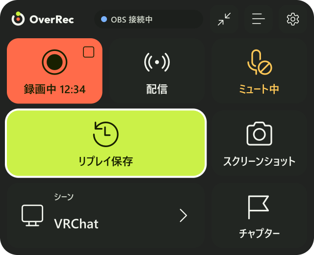

import Link from '@docusaurus/Link';
import YouTube from '@site/src/components/YouTube';

# OverRec

  VR の中から OBS Studio を操作する、手首のパネルです。VR 機器を外さずに、録画・配信の開始と停止、直前の数十秒の保存（リプレイ保存）、スクリーンショットができます。

  <Link className="button button--primary button--lg" to="https://misyaguziya.booth.pm/items/9175989">ダウンロード（BOOTH）</Link>
  <Link className="button button--secondary button--lg" to="/start/install">はじめる</Link>

<YouTube id="MmgiEayaoLs" title="OverRec v1.0.0 紹介動画" />

このドキュメントは OverRec v1.1.1 に対応しています。使っている版は、PC の設定画面の左下に出ています。

## 目的から探す

  <Link className="home-card" to="/start/install"><strong>はじめて使う</strong>インストールから、VR でパネルを出すまで</Link>
  <Link className="home-card" to="/panel"><strong>ボタンを知りたい</strong>録画・配信・リプレイ保存・スクリーンショット・シーン・チャプター・マイク</Link>
  <Link className="home-card" to="/preview"><strong>OBS の画面を見る</strong>映っている画面を、パネルの横で確かめるプレビュー</Link>
  <Link className="home-card" to="/customize"><strong>好みに合わせる</strong>位置と大きさ、小さな表示、付ける手、ボタンの割り当て</Link>
  <Link className="home-card" to="/settings"><strong>設定を調べる</strong>PC の設定画面とパネルの歯車の項目</Link>
  <Link className="home-card" to="/faq"><strong>うまく動かない</strong>よくある症状と、不具合の報告</Link>

## できること

| | |
|---|---|
| リプレイ保存 | ボタンを押すと、直前の数十秒を動画として保存 |
| 録画・配信 | 開始と停止。経過時間をパネルに表示 |
| スクリーンショット | OBS に映っている画面を PNG で保存 |
| シーン | 一覧から選んで切り替え |
| チャプター | 録画中に、あとで探しやすいよう印を付ける |
| マイク | ミュートの切り替え。状態をいつも表示 |
| プレビュー | OBS に映っている画面を、パネルの横で確認 |
| ソース・フィルター | ソースの表示/非表示、フィルターの ON/OFF（スタジオモード対応） |
| NVIDIA App | OBS の代わりに、NVIDIA App の録画・リプレイ保存・スクリーンショットを操作（[NVIDIA App で録画する](/nvidia)） |
| ボタンの割り当て | パネルを開かずに、コントローラーのボタンで操作 |

録画やエンコードは OBS Studio が行います。OverRec は、VR の中から OBS を動かすリモコンです。
VRChat に限らず、SteamVR で遊ぶどのゲームでも使えます。

設定画面とパネルの表示は、日本語・English・한국어・简体中文・繁體中文から選べます。

## 必要な環境

- Windows 11（または 10）の PC
- SteamVR と、SteamVR で使える VR 機器
- OBS Studio 28 以降（OverRec と同じ PC で動かします）。または、NVIDIA の GPU と NVIDIA App

Quest などは、Steam Link・Virtual Desktop（SteamVR モード）・Quest Link で SteamVR につないで使います。
SteamVR を通さない遊び方（VDXR や Meta の OpenXR ランタイム）では利用できません。
