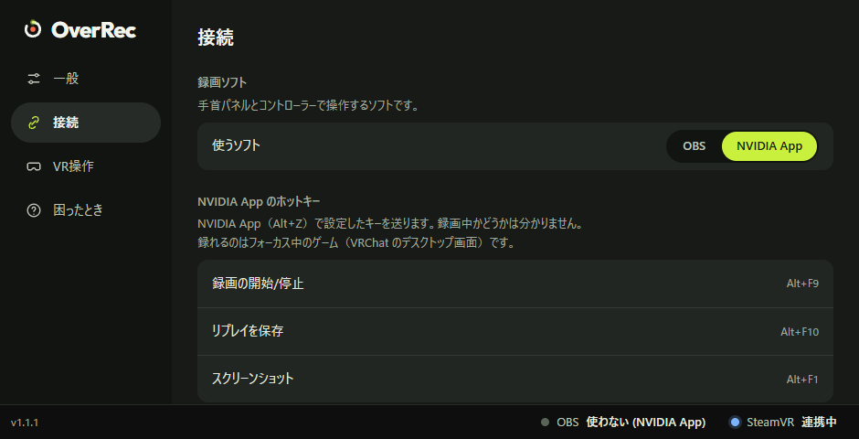
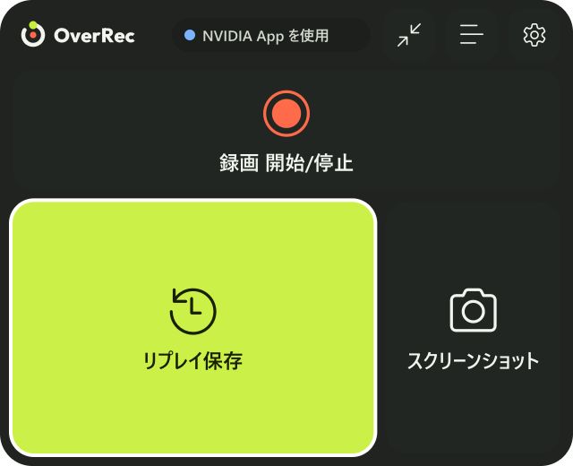

# NVIDIA App で録画する

NVIDIA の GPU を使っていて、録画に NVIDIA App（旧 GeForce Experience の ShadowPlay）を使う場合は、OBS の代わりに NVIDIA App を操作できます。
手首のパネルとコントローラーのボタンから、**録画の開始/停止・リプレイ保存・スクリーンショット** ができます。

OverRec は、NVIDIA App で設定したホットキー（Alt+F10 など）を、押したときに代わりに送ります。

## 切り替える {#switch}

PC の設定画面の **「接続」→「録画ソフト」** で **NVIDIA App** を選びます。VR の中では、[パネルの歯車](/settings/vr) の「録画ソフト」で **NVIDIA** を押しても切り替えられます。

NVIDIA App にすると、次のように変わります。

- OBS にはつながりません。右下の表示は「OBS 使わない (NVIDIA App)」になり、「OBS」のタブは出なくなります。
- 「NVIDIA App のホットキー」に、OverRec が送るキーが出ます。NVIDIA App でキーを変えると、ここも変わります。

OBS に戻すと、OBS につなぎ直します。

## NVIDIA App の準備 {#prepare}

NVIDIA App を開き、次を確かめます。

| 項目 | 内容 |
|---|---|
| NVIDIA オーバーレイ | 設定の「機能」でオンにする。オフだと、OverRec がキーを送っても NVIDIA App が受け取りません |
| インスタントリプレイ | 「リプレイ保存」を使うなら、オンにしておく。保存する長さも NVIDIA App で決めます |
| ホットキー | Alt+Z で開くオーバーレイの設定で決める。OverRec は、ここで設定したキーを送ります |

録画やスクリーンショットの保存先も、NVIDIA App の設定のとおりです。

## パネル {#panel}

NVIDIA App のときは、手首のパネルが、使える 3 つのボタンだけの配置になります。

| ボタン | 内容 |
|---|---|
| 録画 開始/停止 | 押すたびに、NVIDIA App の録画が始まる・止まる |
| リプレイ保存 | NVIDIA App のインスタントリプレイを保存する |
| スクリーンショット | NVIDIA App でスクリーンショットを撮る |

押すと、パネルの上の段に「NVIDIA App にリプレイ保存を送信」のように出ます。

コントローラーの [ボタンの割り当て](/customize#bindings) でも、録画・リプレイ保存・スクリーンショットは NVIDIA App に届きます。

:::note
NVIDIA App は録画中かどうかを外に知らせないので、OverRec にも分かりません。そのため、録画中でもボタンは赤くならず、経過時間も出ません。止めるときの確認もありません。録画中かどうかは、NVIDIA App の通知で確かめてください。
:::

配信・マイク・シーン・チャプター・[プレビュー](/preview)・[ソースとフィルターの ON/OFF](/sources) は、OBS のときだけ使えます。

## 録画される画面 {#what}

NVIDIA App が録るのは、そのとき **PC でフォーカスがあるゲームの画面** です。VRChat なら、デスクトップに出ている VRChat のウィンドウが録画されます（VR の中で見ている映像そのものではありません）。

VR で見ている映像を録りたい、配信もしたい、という場合は OBS を使ってください。

## うまく動かないとき {#trouble}

パネルの上の段とログに、理由が出ます。

| 出る文 | 対処 |
|---|---|
| NVIDIA App のオーバーレイが動いていません | NVIDIA App を起動し、設定の「機能」で NVIDIA オーバーレイをオンにする |
| NVIDIA App にこの操作のホットキーがありません | NVIDIA App（Alt+Z）で、その操作のホットキーを設定する |
| ホットキーを送れません（管理者権限のウィンドウが前面にあるかもしれません） | 管理者として実行しているウィンドウが前にあると、キーを送れません。そのウィンドウを閉じるか、ゲームを前に出す |

「送信」と出たのに録画されないときは、NVIDIA App の設定（インスタントリプレイがオンか、ホットキーが合っているか）と、ゲームにフォーカスがあるかを確かめてください。
