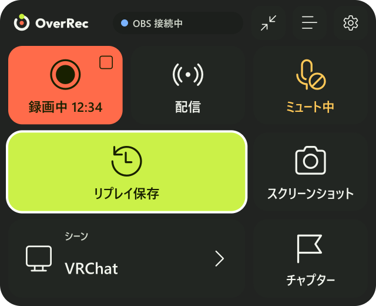
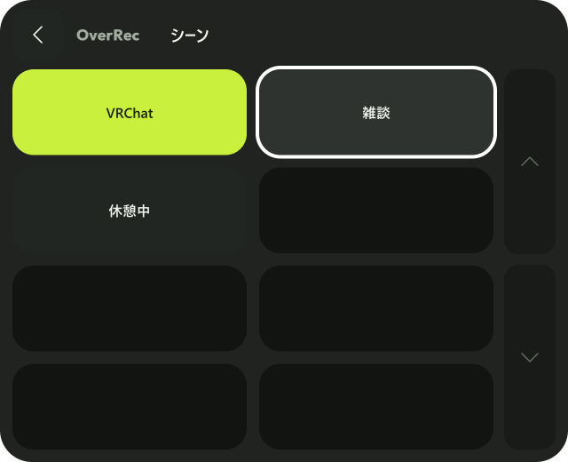
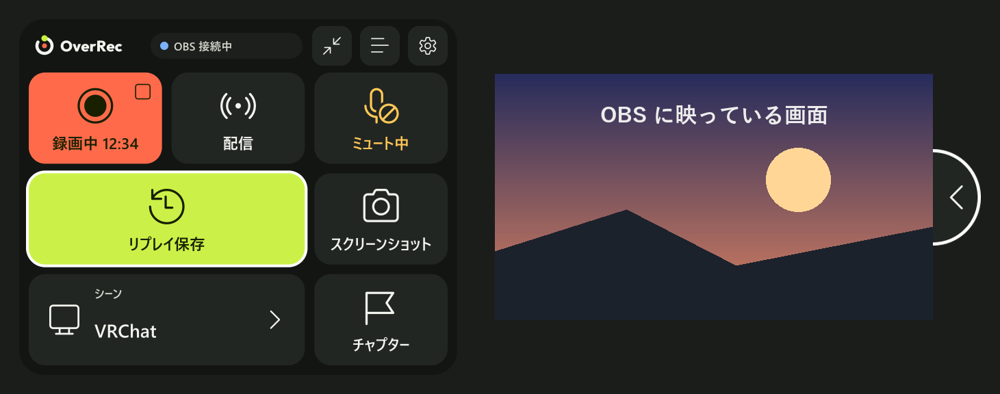

# パネルのボタン

パネルの上の段には、OBS とつながっているか（「OBS 接続中」「OBS 未接続」）が出ます。OBS とつながっていない間は、下のボタンは押せません。

## リプレイ保存 {#replay}

**直前の数十秒を、動画として保存します。** 「今のを残したい」と思ったときに押します。

- 保存できると、コントローラーが振動し、ボタンに「保存しました」と出ます。
- 保存先は、OBS の録画フォルダーです。PC の設定画面の「OBS」→「保存先」の「フォルダーを開く」で開けます。
- 保存する長さは、PC の設定画面の「OBS」→「リプレイバッファ」で選びます。

ボタンが「リプレイ開始」になっているときは、OBS のリプレイバッファが止まっています。押すと始まります。
初期設定では、OBS につながったときに自動で始まります。

## 録画・配信 {#record}

押すと始まり、ボタンが赤くなって経過時間が出ます。

止めるときは、**もう一度押して確定** します。1 回押すと「もう一度押して停止」と出るので、続けてもう一度押します。そのまま数秒たつと、元に戻ります。

配信先や画質などは、OBS で設定したものを使います。

## マイク {#mic}

OBS のマイクのミュートを切り替えます。ミュートの間は「ミュート中」と出ます。

どの音声入力を切り替えるかは、PC の設定画面の「OBS」→「マイクに使う入力」で選びます。

:::note
切り替えるのは OBS に入る音です。ゲームやボイスチャットのマイクは変わりません。
:::

## スクリーンショット {#screenshot}

OBS に映っている画面を、PNG で保存します。保存先は、リプレイと同じ OBS の録画フォルダーです。

## シーン {#scene}

今のシーンの名前が出ています。押すと一覧が開き、選んだシーンに切り替わります。

シーンが多いときは、右の矢印でページを送ります。左上の「＜」で元の画面に戻ります。

## チャプター {#chapter}

録画中に押すと、その時点に印（チャプター）が付きます。あとで編集するときに、場面を探しやすくなります。

- OBS 30.2 以降で、録画中だけ押せます。
- 録画形式が Hybrid MP4 のときだけ記録されます。OBS の「設定」→「出力」→「録画フォーマット」で選びます。

使えるかどうかは、PC の設定画面の「OBS」→「チャプター」に出ます。

## ログと設定 {#menus}

パネルの右上に、3 つのボタンがあります。指すと、名前が出ます。

| ボタン | 内容 |
|---|---|
| 内向きの矢印（小さくする） | パネルを小さくして、[小さな表示](/customize#mini) だけにする |
| ≡（ログ） | 保存したファイルや、うまくいかなかったことの記録 |
| ⚙（設定） | OBS への再接続、付ける手、触覚フィードバックなど（[パネルの歯車](/settings/vr)） |

## OBS の画面を確かめる（プレビュー） {#preview}

パネルの右端にある取っ手を押すと、OBS に映っている画面が、パネルの横にせり出します。

くわしくは [OBS の画面のプレビュー](/preview) で説明します。
