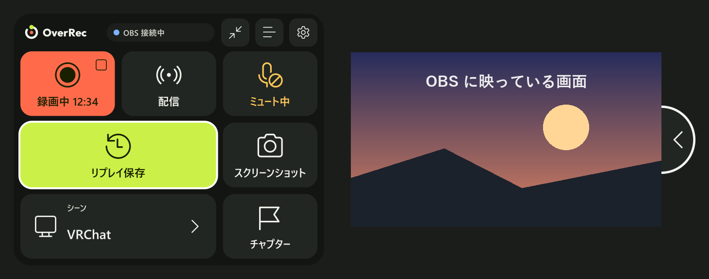
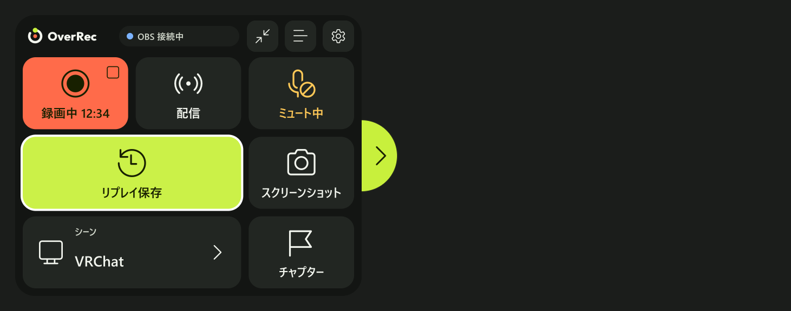
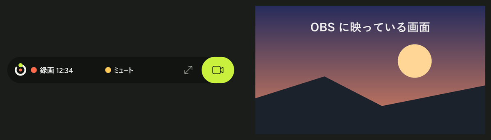

# OBS の画面のプレビュー

**OBS に今映っている画面を、VR の中で確かめられます。** 録画や配信に何が映っているか、シーンが思ったとおりに切り替わったかを、VR 機器を外さずに見られます。

:::note
画像の右側は説明用の絵です。実際には、OBS の今のシーンがそのまま映ります。
:::

## 出す・しまう {#open}

パネルの右端に、半円の **取っ手** が付いています。

1. 右手で取っ手を指して、トリガーを引いて離します。
2. OBS の画面が、パネルの右へせり出します。取っ手も、画面の右端へ一緒に動きます。
3. もう一度取っ手を押すと、画面がしまわれます。

| 取っ手 | 状態 |
|---|---|
| ライムの地に「＞」 | しまってある。押すと出る |
| 暗い地に「＜」 | 出ている。押すとしまう |

## 小さな表示のとき {#small}

パネルを [小さな表示](/customize#mini) にしているときは、右端の **カメラのボタン** で出し入れします。出している間は、ボタンがライムになります。

出したままパネルと小さな表示を切り替えても、プレビューは出たままです。

## 映るもの {#what}

- OBS の **今のシーン**（録画や配信に出ている画面）が映ります。シーンを切り替えると、プレビューも変わります。
- 録画や配信をしていなくても見られます。
- 確認用なので、動きはなめらかではありません（1 秒に数回〜十数回の更新です）。音は出ません。
- プレビューは見るだけで、指して押すことはできません。

## 出る場所と大きさ {#place}

- プレビューは、いつもパネル（または小さな表示）の右に出ます。パネルを [つかんで動かす](/start/basics#grab) と、一緒に動きます。
- 大きさは、パネルの大きさに合わせて変わります。大きく見たいときは、パネルを大きくします。
- 手首を戻してパネルが消えると、プレビューも消えます。もう一度手首を見ると、また出ます。

## OBS への負担 {#load}

OverRec は、**プレビューを出している間だけ**、OBS から画面を取り込みます。しまっている間や、手首を戻してパネルが消えている間は、取り込みません。

OBS の動きが重くなると感じたら、見終わったあとに取っ手を押してしまってください。

## うまく出ないとき {#trouble}

| 症状 | 確かめること |
|---|---|
| 取っ手を押しても何も出ない | OBS とつながっているか（パネルの上の段が「OBS 接続中」か）。最初の画面が届くまで、少し時間がかかることがあります |
| 途中で消えた | OBS との接続が切れると、プレビューはしまわれます。つながり直すと、また出ます |
| 取っ手が見当たらない | 取っ手はパネルと一緒に出ます。小さな表示のときは、取っ手の代わりに右端のカメラのボタンを使います |
| 真っ黒な画面が出る | OBS の今のシーンに、何も映っていません。OBS でソースを確かめます |
| 起動し直したらしまわれていた | プレビューは、OverRec や SteamVR を起動し直すと、しまった状態に戻ります |
