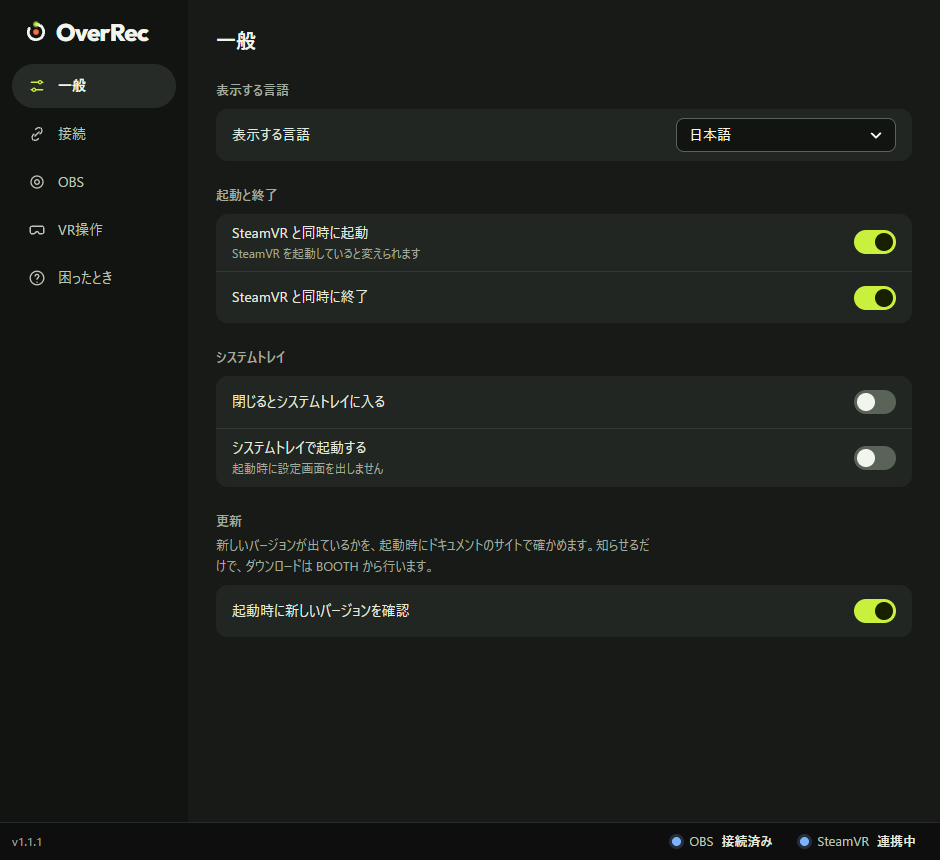
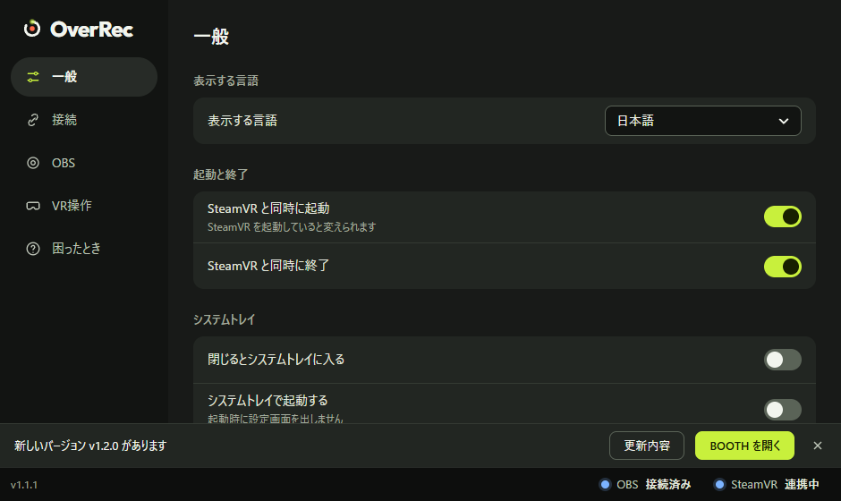
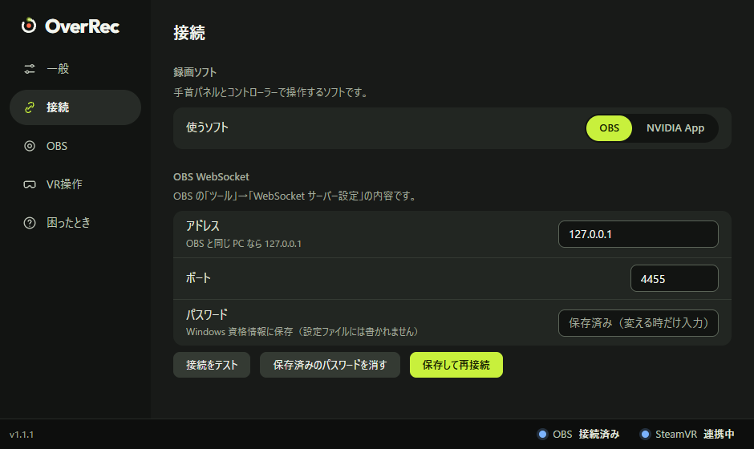
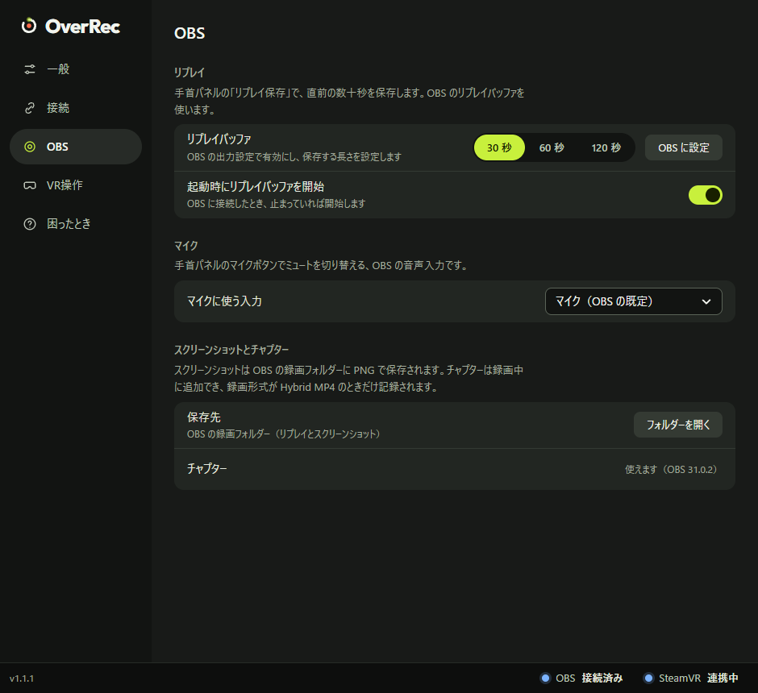
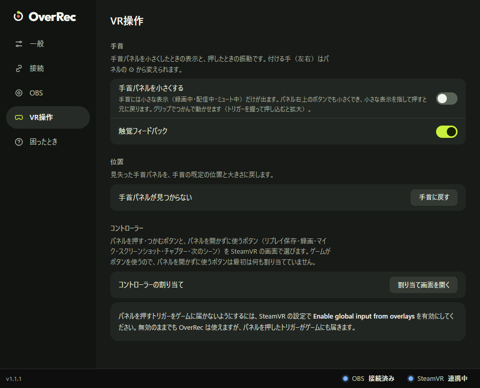
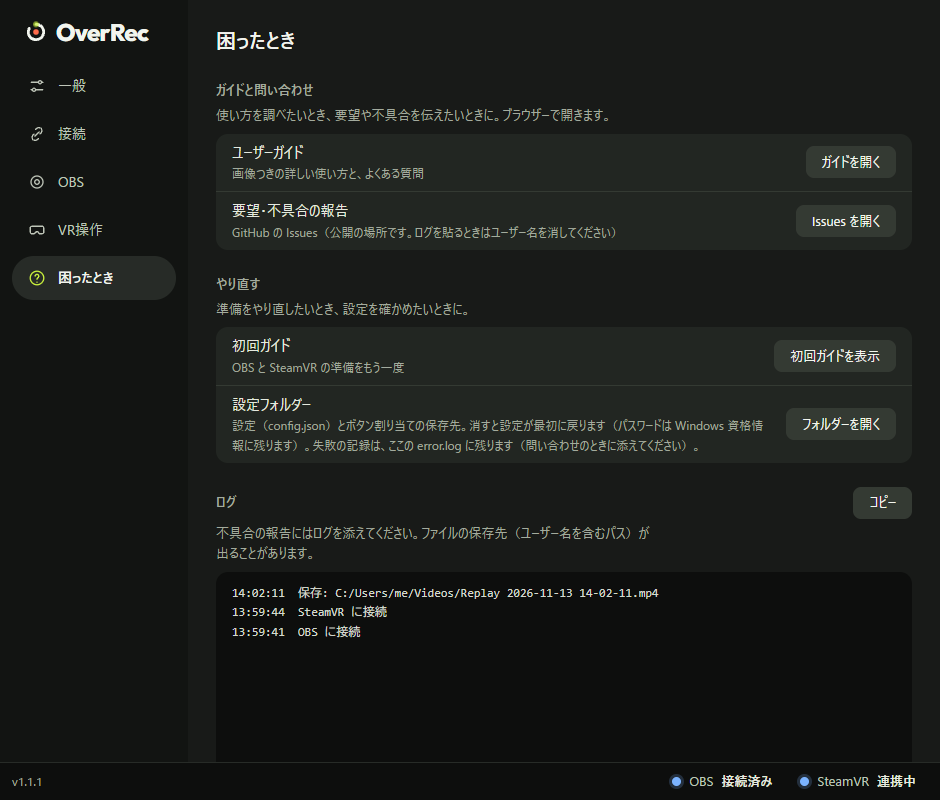
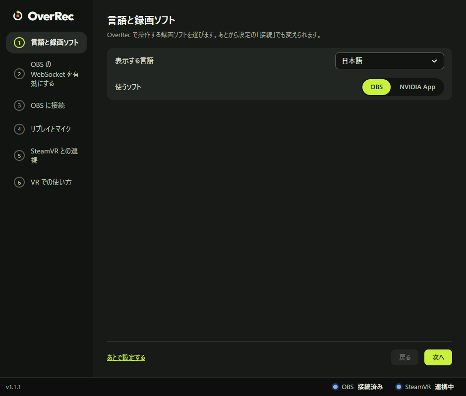

# PC の設定画面

OverRec を起動すると、デスクトップに設定画面が出ます。OBS との接続や、VR での動きは、ここで決めます。

## 画面の見方 {#layout}

| 場所 | 内容 |
|---|---|
| 左の列 | 設定の種類（タブ）。**一般・接続・OBS・VR操作・困ったとき** の 5 つ（録画ソフトが NVIDIA App のときは「OBS」が出ません） |
| 右の広いところ | 選んだタブの項目。項目が多いときは、上下にスクロールします |
| 左下 | OverRec のバージョン |
| 右下 | **OBS** と **SteamVR** の状態。どのタブでも、いつも出ています |

スイッチや選択肢は、**変えたときにすぐ保存されます**。「保存」のボタンがあるのは「接続」だけです。

### 右下の状態 {#status}

| 表示 | 意味 |
|---|---|
| OBS **接続済み**（青い点） | OBS とつながっていて、パネルから操作できる |
| OBS **接続しています**（黄色い点） | OBS につなごうとしている。数秒で「接続済み」か「未接続」になります |
| OBS **未接続** | OBS が起動していない、または接続の設定が合っていない（[OBS につながらない](/faq#no-obs)） |
| OBS **使わない (NVIDIA App)** | 録画ソフトが NVIDIA App なので、OBS にはつながない（[NVIDIA App で録画する](/nvidia)） |
| SteamVR **連携中**（青い点） | SteamVR が動いていて、手首にパネルを出せる |
| SteamVR **未起動** | SteamVR が起動していない。起動すると、数秒で「連携中」になります |

### 開く・閉じる {#window}

| したいこと | 操作 |
|---|---|
| 設定画面を開く | Windows のタスクトレイにある OverRec のアイコンを押す。見当たらないときは、タスクバー右端の「^」を押す |
| トレイにしまう | 設定画面を最小化する |
| OverRec を終了する | 設定画面の「×」を押す。または、トレイのアイコンを右クリックして「終了」 |

「×」で閉じても使い続けたいときは、[閉じるとシステムトレイに入る](#general) をオンにします。

OverRec がすでに動いているときにもう一度起動すると、新しくは起動せず、動いている OverRec の設定画面が前に出ます。

### 新しいバージョンの知らせ {#update}

新しい版が出ていると、起動したときに、画面の下に知らせが出ます。

| ボタン | 内容 |
|---|---|
| 更新内容 | 変わった点をブラウザーで開く |
| BOOTH を開く | ダウンロードのページをブラウザーで開く |
| × | 知らせを閉じる（次に起動したとき、また出ます） |

知らせるだけで、自動では更新しません。新しい版のインストーラーを実行すると、設定を引き継いだまま新しくなります。

## 一般 {#general}

表示する言語と、起動・終了のしかたを決めます（画像は [画面の見方](#layout) のもの）。

| 項目 | 内容 | 最初の設定 |
|---|---|---|
| 表示する言語 | 設定画面と手首のパネルの言語。English・日本語・한국어・简体中文・繁體中文 から選ぶ | インストーラーで選んだ言語 |
| SteamVR と同時に起動 | SteamVR を起動したときに、OverRec も起動する | オフ |
| SteamVR と同時に終了 | SteamVR を終了したときに、OverRec も終了する | オン |
| 閉じるとシステムトレイに入る | 設定画面を「×」で閉じても終了せず、トレイに入る | オフ |
| システムトレイで起動する | 起動したときに設定画面を出さず、トレイに入った状態で始まる | オフ |
| 起動時に新しいバージョンを確認 | 新しい版が出ていたら、[知らせ](#update) を出す | オン |

:::note
「SteamVR と同時に起動」は、SteamVR が動いている間だけ変えられます。動いていないときは、スイッチが押せず、その下に理由が出ます。
:::

## 接続 {#connection}

操作する録画ソフトと、OBS へのつなぎ方です。

**録画ソフト** の「使うソフト」で、手首のパネルとコントローラーで操作するソフトを選びます。最初は **OBS** です。
**NVIDIA App** にすると、下の欄は NVIDIA App のホットキーの表示に変わります（[NVIDIA App で録画する](/nvidia)）。

**OBS WebSocket** には、OBS の「ツール」→「WebSocket サーバー設定」の内容を入れます（[OBS に接続](/start/setup#connect)）。

| 項目 | 内容 |
|---|---|
| アドレス | OBS と同じ PC なら `127.0.0.1` |
| ポート | OBS の「サーバーポート」 |
| パスワード | OBS の「サーバーパスワード」。保存済みのときは「保存済み（変える時だけ入力）」と出ていて、空のままなら保存済みのものを使います |

| ボタン | 内容 |
|---|---|
| 接続をテスト | 入力した内容でつながるかを確かめる。保存はしません。つながると、OBS のバージョンが出ます |
| 保存済みのパスワードを消す | 保存したパスワードを消す（OBS で認証をオフにしたときなど） |
| 保存して再接続 | 入力した内容を保存して、OBS につなぎ直す |

結果は、ボタンの横に出ます。「保存して再接続」では、「保存しました。接続しています…」のあとに、「接続できました」か、つながらなかった理由が出ます。パスワードは Windows の資格情報に保存します。

:::note
別の PC の OBS にもつなげますが、通信は暗号化されません。同じ PC で使うのがおすすめです。
:::

## OBS {#obs}

リプレイ、マイク、保存先など、OBS の使い方を決めます。

| 項目 | 内容 |
|---|---|
| リプレイバッファ | 「リプレイ保存」で保存する長さ（30 秒・60 秒・120 秒）を選び、**「OBS に設定」** を押す |
| 起動時にリプレイバッファを開始 | OBS につながったとき、リプレイバッファが止まっていれば始める（最初はオン） |
| マイクに使う入力 | パネルのマイクのボタンで切り替える、OBS の音声入力。「マイク（OBS の既定）」のままなら、OBS の設定のマイクを使います |
| 保存先 | 「フォルダーを開く」で、OBS の録画フォルダー（リプレイとスクリーンショットの保存先）を開く |
| チャプター | つながっている OBS でチャプターが使えるか |

:::caution
「OBS に設定」は、OBS の出力設定を書き換えます。1 回押すと確かめる文が出るので、よければもう一度押します。
:::

マイクの一覧と「チャプター」の表示は、OBS とつながっているときに出ます。

## VR操作 {#vr}

手首のパネルの出し方と、コントローラーのボタンを決めます。

| 項目 | 内容 |
|---|---|
| 手首パネルを小さくする | 手首に [小さな表示](/customize#mini) だけを出す |
| 触覚フィードバック | 指したとき・押したときなどの、コントローラーの振動（最初はオン） |
| 手首パネルが見つからない | 「手首に戻す」で、パネルを最初の場所と大きさに戻す |
| コントローラーの割り当て | 「割り当て画面を開く」で、SteamVR の [割り当て画面](/customize#bindings) を開く（SteamVR が動いているとき） |

いちばん下には、[パネルを押したトリガーをゲームに届かなくする方法](/start/basics#global-input) が書いてあります。

付ける手（左右）は、ここではなく [パネルの歯車](/settings/vr) で変えます。

## 困ったとき {#help}

使い方を調べる、やり直す、不具合を報告するときに使います。

| 項目 | 内容 |
|---|---|
| ユーザーガイド | 「ガイドを開く」で、このドキュメントをブラウザーで開く |
| 要望・不具合の報告 | 「Issues を開く」で、GitHub の Issues をブラウザーで開く（[不具合の報告](/faq#report)） |
| 初回ガイド | 「初回ガイドを表示」で、[初回の準備](/start/setup) をもう一度行う |
| 設定フォルダー | 「フォルダーを開く」で、設定と、失敗の記録（`error.log`）があるフォルダーを開く |
| ログ | OverRec を起動してからの記録。新しいものが上。「コピー」で写して、不具合の報告に貼れます |

## 初回ガイド {#guide}

初めて起動したときと、「初回ガイドを表示」を押したときは、設定画面が初回ガイドに変わります。

- 左の列が、6 つの手順に変わります（録画ソフトが NVIDIA App のときは、OBS の手順を飛ばして 3 つ）。今の手順に印が付き、済んだ手順にはチェックが付きます。
- 下の「戻る」「次へ」で進みます。最後の手順の「完了」で、設定画面に戻ります。
- 最初の画面で、表示する言語と録画ソフトを選びます。

手順の中身は、[初回の準備](/start/setup) で説明しています。
