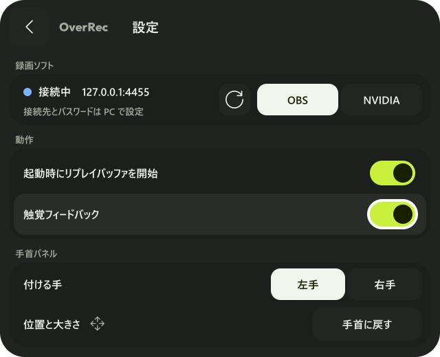

# パネルの歯車

VR の中で、パネル右上の **⚙** を押すと開きます。左上の「＜」で元の画面に戻ります。

| 項目 | 内容 |
|---|---|
| 録画ソフト | OBS につながっているかと、接続先。⟳（再接続）でつなぎ直す。**OBS / NVIDIA** で、操作する録画ソフトを切り替える（[NVIDIA App で録画する](/nvidia)） |
| 起動時にリプレイバッファを開始 | [PC の「OBS」](/settings/pc#obs) の同じ項目 |
| 触覚フィードバック | [PC の「VR操作」](/settings/pc#vr) の同じ項目 |
| 付ける手 | パネルを付ける手（左手・右手）。ここでだけ変えられます（[付ける手](/customize#hand)） |
| 位置と大きさ | 「手首に戻す」で、最初の場所と大きさに戻す |

接続先とパスワードは、VR の中では変えられません。[PC の「接続」](/settings/pc#connection) で変えます。
