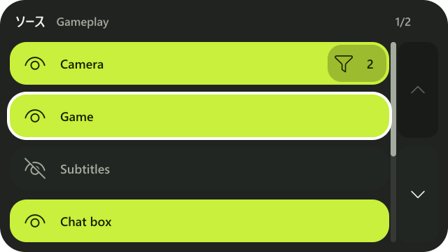
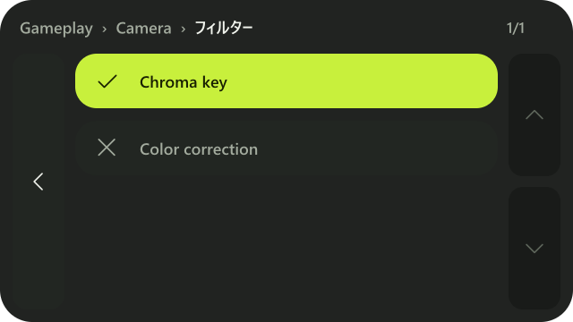
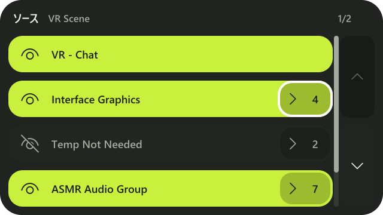
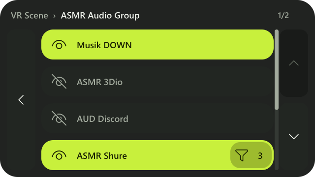

# ソースとフィルターの ON/OFF

**今のシーンのソースを、VR の中で表示/非表示にできます。** ソースにつけたフィルターの ON/OFF も切り替えられます。ゲームのカメラやオーバーレイ、字幕だけを出し入れしたいときに使います。

:::note
できるのは ON/OFF の切り替えだけです。ソースの追加や削除、位置や大きさの変更、フィルターの設定の調整は、PC の OBS で行います。
:::

## 出す・しまう {#open}

パネルの **下の端** に、取っ手があります。

1. 取っ手を指して、トリガーを引いて離します。
2. パネルの下に、ソースの引き出しが出ます。
3. もう一度取っ手を押すと、しまわれます。

引き出しが出るのは、パネルが出ている間だけです。手首を戻してパネルが消えると、引き出しも消えます。

## ソースを切り替える {#toggle}

一覧の 1 行が、1 つのソースです。**行を押すと、表示と非表示が切り替わります。**

| 見た目 | 状態 |
|---|---|
| ライムの地に目のアイコン | 表示されている |
| 暗い地に斜線の入った目 | 非表示 |

- 一度に 4 つ出ます。多いときは、右の上下の矢印でページを送ります。
- 一覧の右の細いバーが、いま全体のどのあたりを見ているかを示します。
- 名前が長いときは、途中で切って出します。

## フィルターを切り替える {#filters}

フィルターがついているソースの行には、右端に **フィルターのボタン**（漏斗のアイコンと数）があります。押すと、そのソースのフィルターの一覧に変わり、行を押して ON/OFF を切り替えます。

画面の左の縦長のボタンで、ソースの一覧に戻ります。

## グループの中を開く {#groups}

OBS のソースの **グループ** は、行の右端のボタンで中を開きます。行そのものを押すと、グループ全体の表示/非表示を切り替えます。

中を開くと、グループの中のソースが出ます。グループの中にグループがあっても、同じように開けます。

- 上の見出しに、**いまいる場所** が「シーン名 › グループ名」のように出ます。いちばん右が今の場所で、手前は暗く出ます。深くて入りきらないときは、手前を「…」で省きます。
- 左の縦長のボタンで、ひとつ前に戻ります。
- 開く・戻るときは、一覧が横に動きます。進むときは右から、戻るときは左から入ります。ページを送るときは縦に動きます。

## スタジオモードのとき {#studio}

OBS の **スタジオモード** を使っているときは、引き出しには、**プレビュー側のシーン** のソースが出ます。見出しに「プレビュー」と出るので、見分けられます。

ここで切り替えたものは、プレビュー側だけに反映されます。配信や録画に出る画面は、PC の OBS で「トランジション」を実行するまで変わりません。

スタジオモードを入り切りしたときや、プレビューのシーンを変えたときは、一覧がそのシーンのものに変わります。

## うまく出ないとき {#trouble}

| 症状 | 確かめること |
|---|---|
| 取っ手が見当たらない | パネルの下の端です。パネルを出し、手首を見て確かめます |
| 押しても切り替わらない | OBS とつながっているか（パネルの上の段が「OBS 接続中」か） |
| 一覧に何も出ない | そのシーン（スタジオモードではプレビュー側のシーン）に、ソースがありません |
| 行が思ったソースと違う | シーンを切り替えると、引き出しもそのシーンの一覧に変わります |
