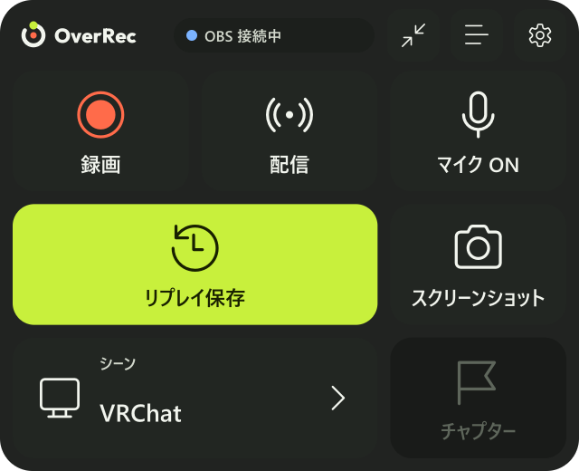
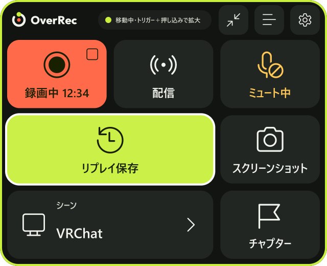

# 基本の操作

SteamVR、OBS Studio、OverRec を起動しておきます。PC の設定画面の右下で、**OBS** が「接続済み」、**SteamVR** が「連携中」になっていれば準備ができています。

## パネルを出す {#show}

腕時計を見るように、**左手首を顔に向けます**。手首にパネルが出ます。手首を戻すと消えます。

右手に付けたいときは、パネルの歯車から変えられます（[付ける手](/customize#hand)）。

## ボタンを押す {#press}

**もう片方の手（初期設定では右手）のコントローラーでボタンを指し、トリガーを引いて離します。**

- 指しているところに、白い丸が出ます。
- 引いたボタンの上で離すと押せます。離す前にボタンの外へ動かすと、押したことになりません。
- 録画と配信の **停止** は、もう一度押して確定します（押し間違いで止まらないように）。

それぞれのボタンは、[パネルのボタン](/panel) で説明します。

## パネルをつかんで動かす {#grab}

右手でパネルを指して **グリップを握る** と、パネルをつかめます。

| したいこと | 操作 |
|---|---|
| 動かす | グリップを握ったまま、手を動かす |
| 前後に動かす | つかんだまま、スティックを上下に倒す |
| 大きさを変える | つかんだままトリガーも握り、手を前に押すと大きく、引くと小さく |
| その場所に置く | グリップを離す |

置いた場所は、手首からの位置として覚えます。手首から遠くに置くと、手首の元の場所に戻ります。
見失ったときは、[手首に戻す](/customize#reset) で元の場所と大きさに戻せます。

## パネルを押すとゲームも反応するとき {#global-input}

パネルを押したトリガーをゲームに届かないようにするには、SteamVR の設定で **「Enable global input from overlays」** を有効にします。
無効のままでも OverRec は使えますが、パネルを押したトリガーがゲームにも届きます。

## 終了する

Windows のタスクトレイにある OverRec のアイコンを右クリックし、「終了」を選びます。
アイコンが見当たらないときは、タスクバー右端の「^」を押すと出ます。
