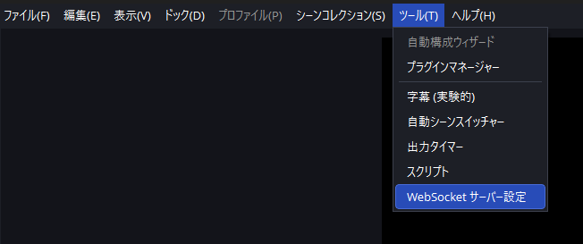
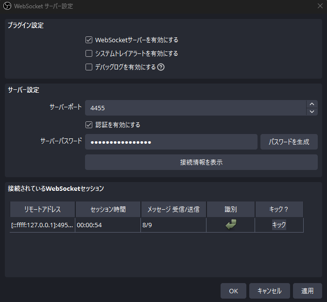

# 初回の準備

OverRec を初めて起動すると、**初回ガイド** が開きます。5 つの手順を順に進めます。PC の前で 5 分ほどです。

あとでやり直したいときは、設定画面の「困ったとき」→「初回ガイドを表示」から開けます。

## 1. OBS の WebSocket を有効にする {#websocket}

OverRec は、OBS の WebSocket という機能を通して OBS を操作します。OBS で一度だけ有効にします。

1. OBS Studio のメニューで **「ツール」** を開きます。
2. **「WebSocket サーバー設定」** を選びます。

   

3. **「WebSocketサーバーを有効にする」** にチェックを入れます。「認証を有効にする」はオンのままにします。
4. **「適用」** を押します。

   

## 2. OBS に接続 {#connect}

同じ「WebSocket サーバー設定」の画面にある内容を、OverRec に入力します。

| OverRec の欄 | 入れるもの |
|---|---|
| アドレス | OBS と同じ PC なら `127.0.0.1` のまま |
| ポート | OBS の「サーバーポート」 |
| パスワード | OBS の「サーバーパスワード」。伏せ字なので、「接続情報を表示」で確認・コピーします |

「次へ」を押すと、つながるかを確かめてから進みます。つながらないときは、その場で理由が出ます。

## 3. リプレイとマイク {#replay}

- **リプレイバッファ**：「今の数十秒を保存」に使う OBS の機能です。長さ（30 秒・60 秒・120 秒）を選んで **「OBS に設定」** を押します。OBS の出力設定を書き換えるので、もう一度押して確定します。
- **マイクに使う入力**：パネルのマイクのボタンでミュートを切り替える、OBS の音声入力を選びます。

:::note
「OBS に設定」を押してもリプレイ保存が動かないときは、OBS を起動し直してください。
:::

## 4. SteamVR との連携 {#steamvr}

- **SteamVR と同時に起動**：オンにすると、SteamVR を起動したときに OverRec も起動します。
- **コントローラーの割り当て**：パネルを開かずに使うボタンを決めます（[ボタンの割り当て](/customize#bindings)）。あとからでも設定できます。

この手順は、SteamVR を起動していると設定できます。起動していないときは飛ばして、あとで「一般」から変えられます。

## 5. VR での使い方

最後に、VR の中での使い方が出ます。「完了」を押すと設定画面に変わります。

続けて [基本の操作](/start/basics) へ進んでください。

## 設定画面を閉じたあと

- 設定画面を **最小化** すると、Windows のタスクトレイに入ります。トレイの OverRec のアイコンを押すと、また開きます。
- 設定画面を **「×」で閉じると、OverRec は終了します**。閉じても使い続けたいときは、「一般」→「閉じるとシステムトレイに入る」をオンにします。
- 初期設定では、SteamVR を終了すると OverRec も終了します。
