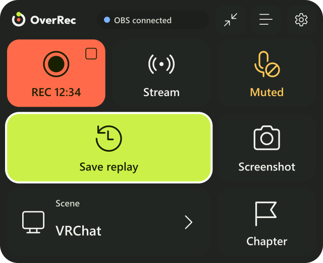

import Link from '@docusaurus/Link';
import YouTube from '@site/src/components/YouTube';

# OverRec

  A wrist panel that controls OBS Studio from inside VR. Without taking your headset off, you can start and stop recording and streaming, save the last few tens of seconds (a replay), and take screenshots.

  <Link className="button button--primary button--lg" to="https://misyaguziya.booth.pm/items/9175989">Download (BOOTH)</Link>
  <Link className="button button--secondary button--lg" to="/start/install">Get started</Link>

<YouTube id="MmgiEayaoLs" title="OverRec v1.0.0 introduction video" />

These docs are for OverRec v1.0.0. Your version is shown at the bottom left of the PC settings window.

## Find by goal

  <Link className="home-card" to="/start/install"><strong>First time</strong>From installing to showing the panel in VR</Link>
  <Link className="home-card" to="/panel"><strong>Learn the buttons</strong>Record, stream, save replay, screenshot, scene, chapter, mic</Link>
  <Link className="home-card" to="/preview"><strong>See what OBS shows</strong>The preview: what is on air, beside the panel</Link>
  <Link className="home-card" to="/customize"><strong>Customize</strong>Position and size, the small sign, which hand, controller bindings</Link>
  <Link className="home-card" to="/settings"><strong>Look up a setting</strong>The PC settings window and the panel's gear</Link>
  <Link className="home-card" to="/faq"><strong>Something's wrong</strong>Common problems, and how to report a bug</Link>

## What it does

| | |
|---|---|
| Save replay | Press the button to save the last few tens of seconds as a video |
| Record and stream | Start and stop. The elapsed time is shown on the panel |
| Screenshot | Saves what OBS shows as a PNG |
| Scene | Choose from the list to switch |
| Chapter | Marks a moment while recording, so it is easy to find later |
| Mic | Mutes and unmutes. Its state is always shown |
| Preview | See what OBS shows, beside the panel |
| Controller bindings | Use controller buttons without opening the panel |

OBS Studio does the recording and encoding. OverRec is a remote that works OBS from inside VR.
It is not only for VRChat: it works with any game you play through SteamVR.

The settings window and the panel can be shown in English, 日本語, 한국어, 简体中文 and 繁體中文.

## Requirements

- A PC with Windows 11 (or 10)
- SteamVR and a VR headset that works with SteamVR
- OBS Studio 28 or later (running on the same PC as OverRec)

With a Quest and the like, connect to SteamVR through Steam Link, Virtual Desktop (SteamVR mode) or Quest Link.
It does not work when you play without SteamVR (VDXR or Meta's OpenXR runtime).
