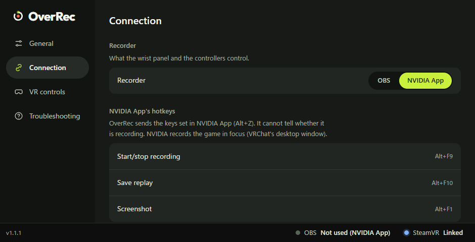
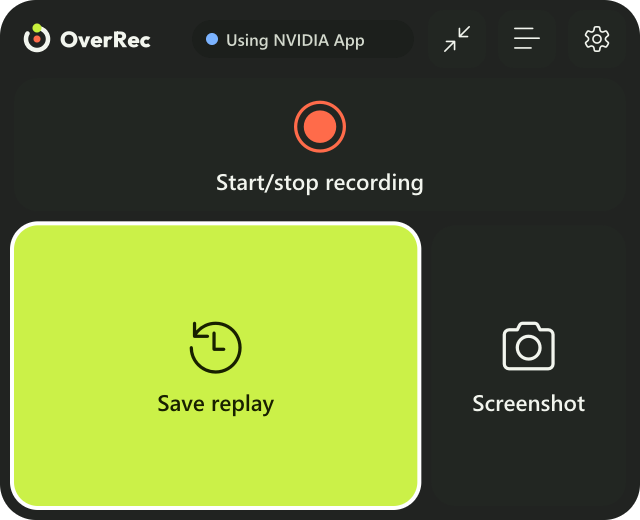

# Recording with NVIDIA App

If you have an NVIDIA GPU and record with NVIDIA App (ShadowPlay, formerly in GeForce Experience), OverRec can work NVIDIA App instead of OBS.
From the wrist panel and the controller buttons, you can **start and stop recording, save a replay and take a screenshot**.

When you press a button, OverRec sends the hotkey set in NVIDIA App (such as Alt+F10) for you.

## Switching {#switch}

In the PC settings window, choose **NVIDIA App** under **"Connection" → "Recorder"**. Inside VR, you can also press **NVIDIA** under "Recorder" in [the panel's gear](/settings/vr).

With NVIDIA App:

- OverRec does not connect to OBS. The bottom right shows "OBS Not used (NVIDIA App)", and the "OBS" tab is not shown.
- "NVIDIA App's hotkeys" shows the keys OverRec sends. When you change a key in NVIDIA App, it changes here too.

Switching back to OBS connects to OBS again.

## Getting NVIDIA App ready {#prepare}

Open NVIDIA App and check these.

| Item | What to do |
|---|---|
| NVIDIA Overlay | Turn it on under "Features" in the settings. When it is off, NVIDIA App does not take the keys OverRec sends |
| Instant Replay | Turn it on to use "Save replay". The length it keeps is set in NVIDIA App too |
| Hotkeys | Set in the overlay's settings, opened with Alt+Z. OverRec sends the keys set there |

Recordings and screenshots are saved where NVIDIA App's settings say.

## The panel {#panel}

With NVIDIA App, the wrist panel has only the three buttons that work.

| Button | What it does |
|---|---|
| Start/stop recording | Each press starts or stops NVIDIA App's recording |
| Save replay | Saves NVIDIA App's Instant Replay |
| Screenshot | Takes a screenshot with NVIDIA App |

After a press, the top row of the panel says, for example, "Sent save replay to NVIDIA App".

With [controller bindings](/customize#bindings), recording, saving a replay and screenshots go to NVIDIA App too.

:::note
NVIDIA App does not tell other apps whether it is recording, so OverRec cannot tell either. The button does not turn red while recording, no elapsed time is shown, and stopping does not ask you to confirm. Check NVIDIA App's notifications to see whether it is recording.
:::

Streaming, mic, scenes, chapters, [the preview](/preview) and [turning sources and filters on and off](/sources) work only with OBS.

## What gets recorded {#what}

NVIDIA App records **the game that has focus on the PC**. With VRChat, that is VRChat's window on the desktop (not the view you see in VR itself).

To record what you see in VR, or to stream, use OBS.

## When it does not work {#trouble}

The reason is shown on the panel's top row and in the log.

| Message | What to do |
|---|---|
| NVIDIA App's overlay is not running | Start NVIDIA App and turn on NVIDIA Overlay under "Features" in its settings |
| NVIDIA App has no hotkey for this | Set a hotkey for that action in NVIDIA App (Alt+Z) |
| Cannot send the hotkey (a window running as administrator may be in front) | Keys cannot be sent while a window running as administrator is in front. Close that window, or bring the game to the front |

If it says "Sent" but nothing is recorded, check NVIDIA App's settings (Instant Replay is on, the hotkeys match) and that the game has focus.
