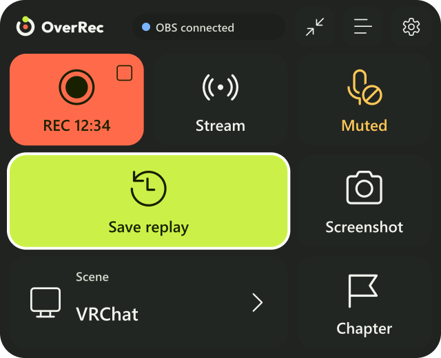
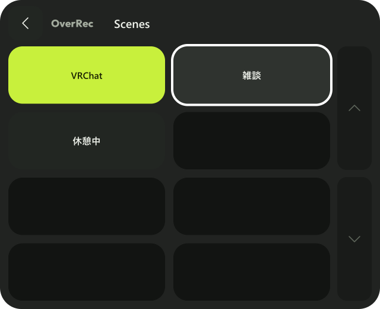
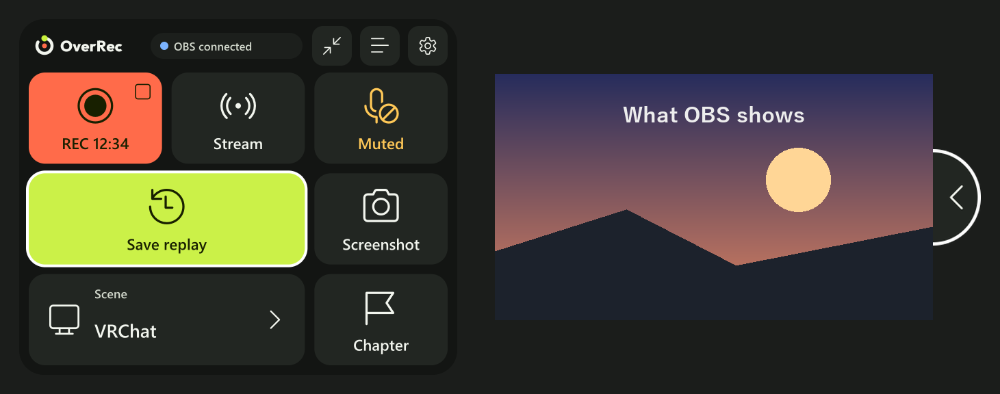

# The panel's buttons

The top row shows whether OBS is connected ("OBS connected" or "OBS not connected"). While OBS is not connected, the buttons below cannot be pressed.

When the recorder is NVIDIA App, there are three buttons: record, save replay and screenshot ([Recording with NVIDIA App](/nvidia#panel)).

## Save replay {#replay}

**Saves the last few tens of seconds as a video.** Press it when you want to keep what just happened.

- When it is saved, the controller vibrates and the button says "Saved".
- It is saved in OBS's recording folder. Open it with "OBS" → "Save location" → "Open folder" in the PC settings window.
- Choose how long to keep in "OBS" → "Replay buffer" in the PC settings window.

When the button says "Start replay", OBS's replay buffer is stopped. Pressing it starts it.
By default it starts by itself when OverRec connects to OBS.

## Record and Stream {#record}

Pressing starts it: the button turns red and shows the elapsed time.

To stop, **press again to confirm**. One press shows "Press again to stop"; press once more. Left alone for a few seconds, it goes back.

The stream destination, quality and so on are what you set in OBS.

## Mic {#mic}

Mutes and unmutes the mic in OBS. While muted it says "Muted".

Choose which audio input it switches in "OBS" → "Mic input" in the PC settings window.

:::note
It switches the sound going into OBS. Your mic in the game or in voice chat does not change.
:::

## Screenshot {#screenshot}

Saves what OBS shows as a PNG, in the same OBS recording folder as replays.

## Scene {#scene}

It shows the current scene's name. Pressing it opens the list; the scene you choose is switched to.

With many scenes, turn pages with the arrows on the right. "＜" at the top left goes back.

## Chapter {#chapter}

Pressed while recording, it marks that moment (a chapter), which makes scenes easier to find when editing.

- It can be pressed only while recording, with OBS 30.2 or later.
- It is kept only when the recording format is Hybrid MP4. Choose it in OBS's "Settings" → "Output" → "Recording Format".

Whether chapters are available is shown in "OBS" → "Chapters" in the PC settings window.

## Sources and filters {#sources}

The handle on the panel's bottom edge brings out the sources drawer. It shows or hides the current scene's sources and turns their filters on or off. [Turning sources and filters on and off](/sources) explains it in full.

## Log and settings {#menus}

There are three buttons at the top right of the panel. Point at one and its name appears.

| Button | What it does |
|---|---|
| Inward arrows (make small) | Makes the panel small, leaving only [the small sign](/customize#mini) |
| ≡ (log) | What was saved, and what went wrong |
| ⚙ (settings) | Reconnecting to OBS, which hand, haptic feedback and more ([The panel's gear](/settings/vr)) |

## Seeing what OBS shows (preview) {#preview}

Press the handle on the panel's right edge and what OBS shows slides out beside the panel.

[The OBS preview](/preview) explains it in full.
