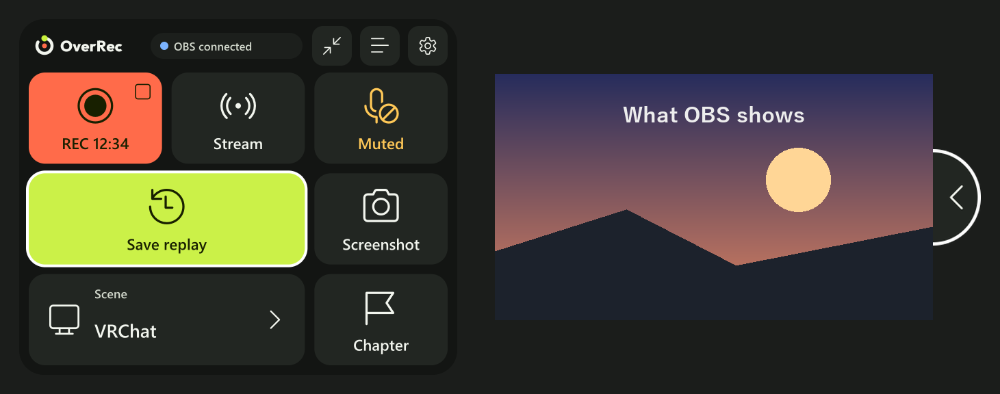
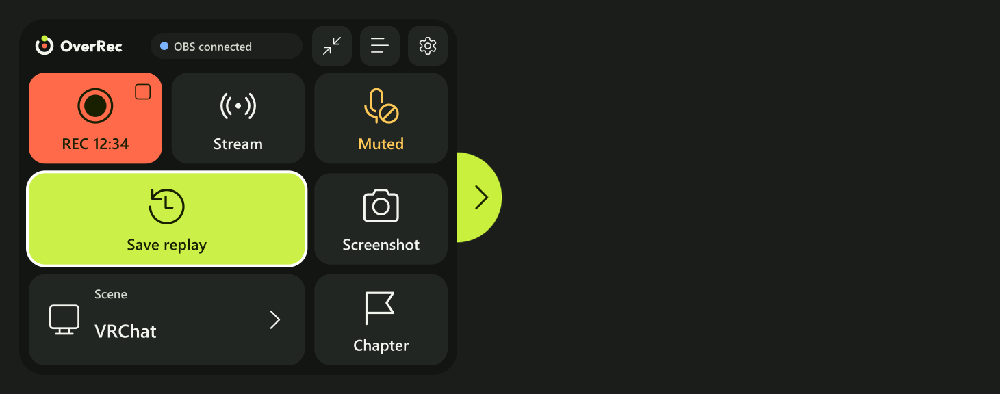
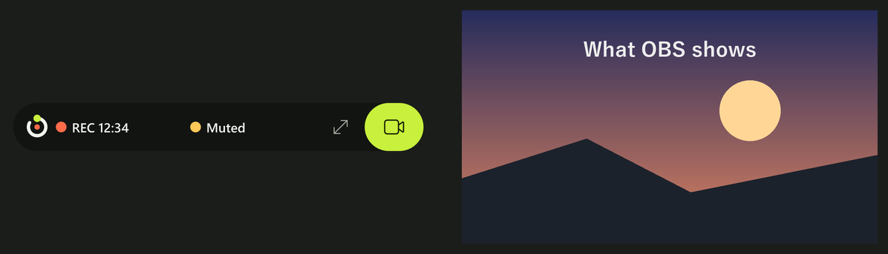

# The OBS preview

**You can see what OBS is showing right now, inside VR.** Check what is going into the recording or the stream, or that the scene changed as you meant, without taking your headset off.

:::note
The right side of the picture is a drawing for this page. In VR it shows OBS's current scene as it is.
:::

## Opening and closing it {#open}

There is a half-round **handle** on the panel's right edge.

1. Point at the handle with your right hand, pull the trigger and let go.
2. What OBS shows slides out to the right of the panel. The handle moves with it, to the picture's right edge.
3. Press the handle again to put it away.

| Handle | State |
|---|---|
| "＞" on lime | Put away. Pressing it brings the preview out |
| "＜" on a dark face | Out. Pressing it puts the preview away |

## With the small sign {#small}

With the panel made [small](/customize#mini), use the **camera button** at its right end. The button is lime while the preview is out.

Switching between the panel and the small sign leaves the preview out.

## What it shows {#what}

- OBS's **current scene** (what goes into the recording or the stream). Switch scenes and the preview changes too.
- It works without recording or streaming.
- It is for checking, so it is not smooth (it updates from a few to a dozen or so times a second). There is no sound.
- The preview is only for looking: it cannot be pointed at and pressed.

## Where it appears, and its size {#place}

- The preview is always to the right of the panel (or the small sign). [Grab and move](/start/basics#grab) the panel and it moves along.
- Its size follows the panel's. To see it bigger, make the panel bigger.
- When you turn your wrist away and the panel goes, so does the preview. Look at your wrist again and it is back.

## Load on OBS {#load}

OverRec takes the picture from OBS **only while the preview is out**. It does not while the preview is put away, or while the panel is gone with your wrist turned away.

If OBS feels slower, press the handle to put the preview away when you are done looking.

## When it does not come out {#trouble}

| Problem | What to check |
|---|---|
| Nothing comes out when I press the handle | Whether OBS is connected (the top row of the panel says "OBS connected"). The first picture can take a moment to arrive |
| It went away by itself | When the connection to OBS is lost, the preview is put away. It comes back when OBS is connected again |
| I can't find the handle | The handle appears with the panel. With the small sign, use the camera button at its right end instead |
| The picture is black | Nothing is in OBS's current scene. Check the sources in OBS |
| It was put away after restarting | The preview starts put away whenever OverRec or SteamVR is restarted |
