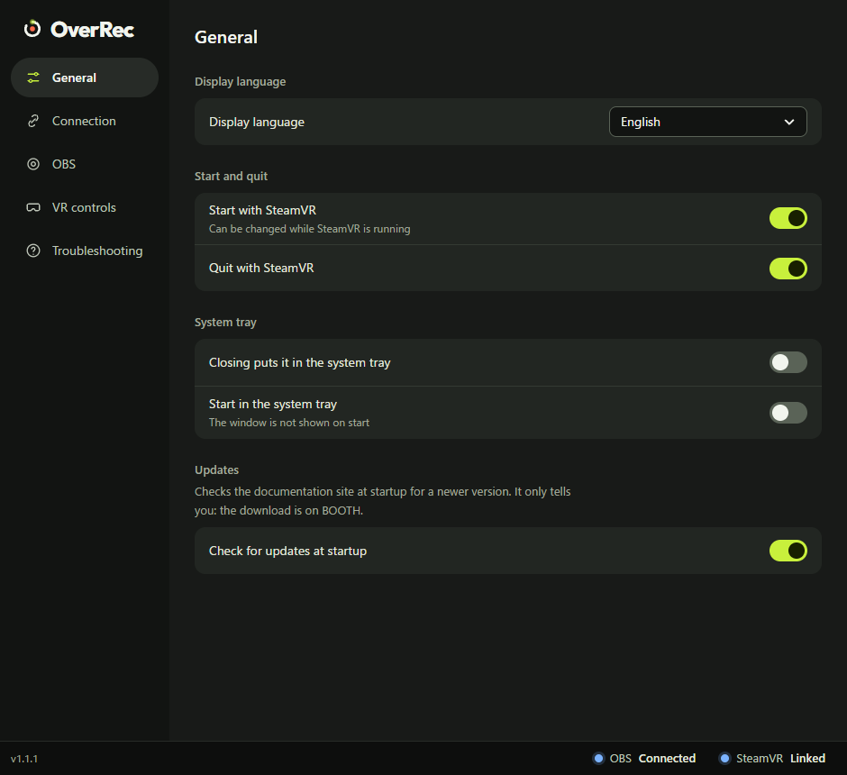
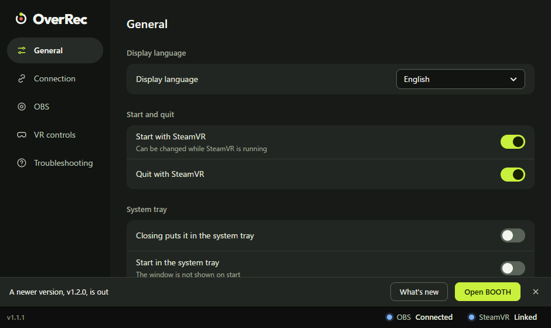
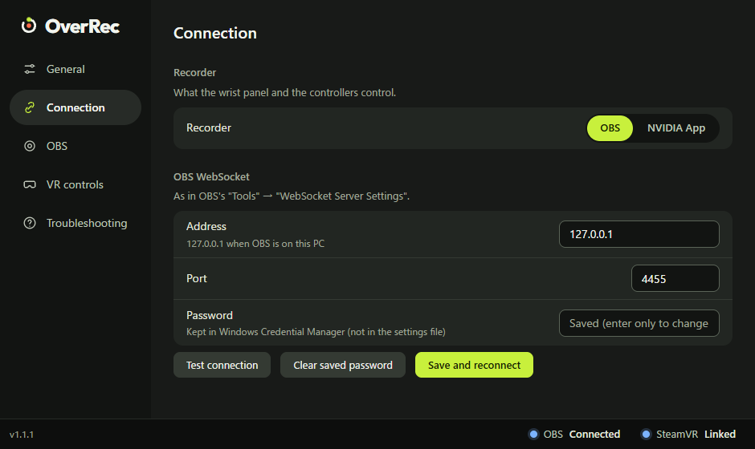
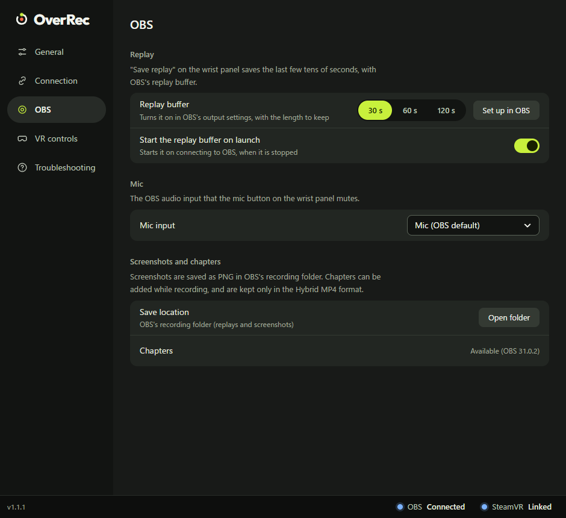
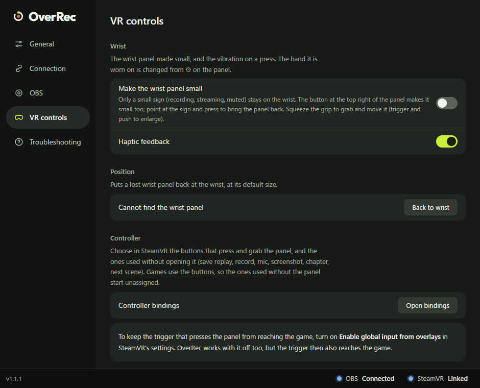
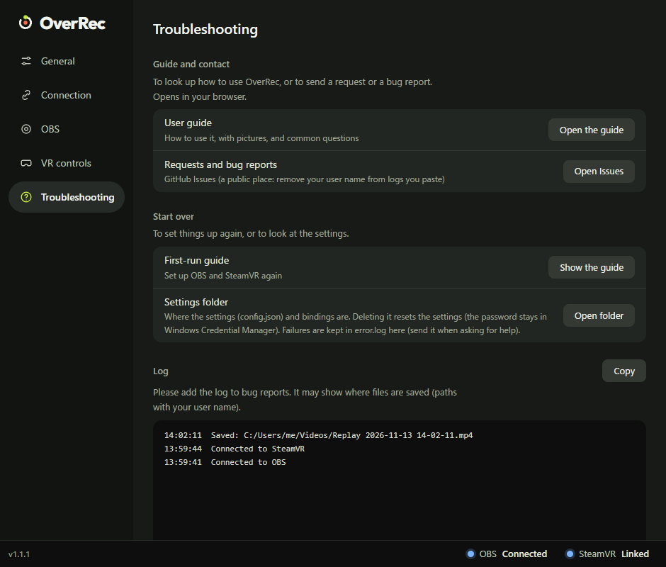
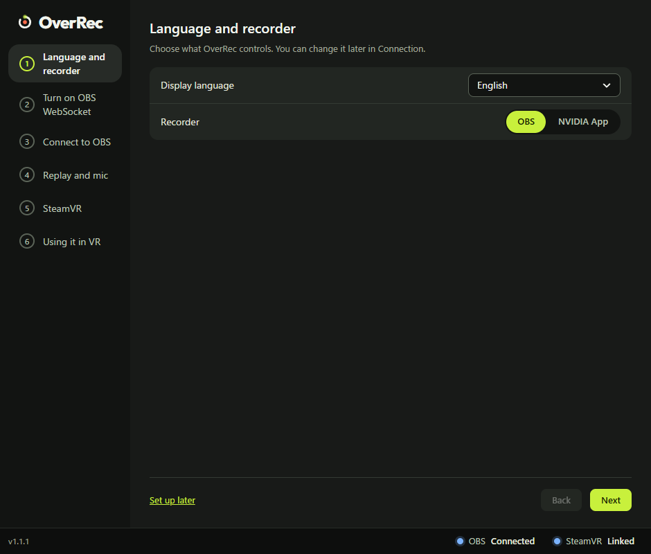

# The PC settings window

When OverRec starts, its settings window appears on the desktop. The connection to OBS and how OverRec behaves in VR are set here.

## Reading the window {#layout}

| Where | What it is |
|---|---|
| The left column | The kinds of settings (tabs): **General, Connection, OBS, VR controls, Troubleshooting** (without "OBS" when the recorder is NVIDIA App) |
| The wide area on the right | The chosen tab's items. With many items, scroll up and down |
| Bottom left | OverRec's version |
| Bottom right | The state of **OBS** and **SteamVR**. Always shown, on every tab |

Switches and choices are **saved as soon as you change them**. Only "Connection" has a save button.

### The state at the bottom right {#status}

| Shown | Meaning |
|---|---|
| OBS **Connected** (blue dot) | OBS is connected and can be worked from the panel |
| OBS **Connecting…** (yellow dot) | It is trying to connect to OBS. In a few seconds this turns to "Connected" or "Not connected" |
| OBS **Not connected** | OBS is not running, or the connection settings do not match ([It does not connect to OBS](/faq#no-obs)) |
| OBS **Not used (NVIDIA App)** | The recorder is NVIDIA App, so OverRec does not connect to OBS ([Recording with NVIDIA App](/nvidia)) |
| SteamVR **Linked** (blue dot) | SteamVR is running and the panel can appear on your wrist |
| SteamVR **Not running** | SteamVR is not running. Start it and this turns to "Linked" in a few seconds |

### Opening and closing {#window}

| To | Do this |
|---|---|
| Open the settings window | Press OverRec's icon in the Windows system tray. If you cannot see it, press "^" at the right end of the taskbar |
| Put it away in the tray | Minimize the settings window |
| Quit OverRec | Press "×" on the settings window, or right-click the tray icon and choose "Quit" |

To keep using OverRec after closing with "×", turn on [Closing puts it in the system tray](#general).

Starting OverRec while it is already running does not start another: the running one's settings window comes to the front.

### The notice of a newer version {#update}

When a newer version is out, a notice appears at the bottom of the window on start.

| Button | What it does |
|---|---|
| What's new | Opens what changed, in your browser |
| Open BOOTH | Opens the download page, in your browser |
| × | Closes the notice (it appears again on the next start) |

It only tells you: nothing is updated by itself. Run the new version's installer and OverRec is updated, with your settings kept.

## General {#general}

The display language, and how OverRec starts and quits (pictured in [Reading the window](#layout)).

| Item | What it does | At first |
|---|---|---|
| Display language | The language of the settings window and the wrist panel: English, 日本語, 한국어, 简体中文 or 繁體中文 | The language chosen in the installer |
| Start with SteamVR | Starts OverRec when SteamVR starts | Off |
| Quit with SteamVR | Quits OverRec when SteamVR quits | On |
| Closing puts it in the system tray | Closing the window with "×" keeps OverRec running in the tray | Off |
| Start in the system tray | Starts in the tray, without showing the settings window | Off |
| Check for updates at startup | Shows [the notice](#update) when a newer version is out | On |

:::note
"Start with SteamVR" can be changed only while SteamVR is running. When it is not, the switch cannot be pressed and the reason is shown under it.
:::

## Connection {#connection}

The recorder OverRec works, and how to reach OBS.

Under **Recorder**, choose what the wrist panel and the controllers work. It is **OBS** at first.
With **NVIDIA App**, the section below shows NVIDIA App's hotkeys instead ([Recording with NVIDIA App](/nvidia)).

Under **OBS WebSocket**, enter what OBS's "Tools" → "WebSocket Server Settings" shows ([Connect to OBS](/start/setup#connect)).

| Item | What it does |
|---|---|
| Address | `127.0.0.1` when OBS is on the same PC |
| Port | OBS's "Server Port" |
| Password | OBS's "Server Password". When one is saved it says "Saved (enter only to change it)"; left empty, the saved one is used |

| Button | What it does |
|---|---|
| Test connection | Tries a connection with what is entered. Nothing is saved. When it connects, OBS's version is shown |
| Clear saved password | Removes the saved password (when you turned authentication off in OBS, say) |
| Save and reconnect | Saves what is entered and connects to OBS again |

The result is shown beside the buttons. With "Save and reconnect", "Saved. Connecting…" is followed by "Connected" or the reason it could not connect. The password is kept in Windows Credential Manager.

:::note
OBS on another PC works too, but the connection is not encrypted. Using it on the same PC is recommended.
:::

## OBS {#obs}

How OBS is used: the replay, the mic, where things are saved.

| Item | What it does |
|---|---|
| Replay buffer | Choose the length "Save replay" keeps (30 s, 60 s or 120 s) and press **"Set up in OBS"** |
| Start the replay buffer on launch | Starts the replay buffer on connecting to OBS, when it is stopped (on at first) |
| Mic input | The OBS audio input that the panel's mic button switches. Left at "Mic (OBS default)", the mic set in OBS is used |
| Save location | "Open folder" opens OBS's recording folder (where replays and screenshots are saved) |
| Chapters | Whether the connected OBS can add chapters |

:::caution
"Set up in OBS" changes OBS's output settings. One press asks you to confirm; press once more to go ahead.
:::

The list of mics and "Chapters" are shown while OBS is connected.

## VR controls {#vr}

How the wrist panel appears, and the controller buttons.

| Item | What it does |
|---|---|
| Make the wrist panel small | Shows only [the small sign](/customize#mini) on the wrist |
| Haptic feedback | The controller's vibration on pointing, pressing and so on (on at first) |
| Cannot find the wrist panel | "Back to wrist" puts the panel back at its first place and size |
| Controller bindings | "Open bindings" opens SteamVR's [bindings window](/customize#bindings) (while SteamVR is running) |

At the bottom is [how to keep the trigger that presses the panel from reaching the game](/start/basics#global-input).

The hand the panel is worn on is not changed here but in [the panel's gear](/settings/vr).

## Troubleshooting {#help}

For looking up how to use OverRec, starting over, and reporting a bug.

| Item | What it does |
|---|---|
| User guide | "Open the guide" opens these docs in your browser |
| Requests and bug reports | "Open Issues" opens GitHub Issues in your browser ([Bug reports](/faq#report)) |
| First-run guide | "Show the guide" does the [first-time setup](/start/setup) again |
| Settings folder | "Open folder" opens the folder with the settings and the record of failures (`error.log`) |
| Log | What happened since OverRec started, newest first. "Copy" copies it, to paste into a bug report |

## The first-run guide {#guide}

On the first start, and when you press "Show the guide", the settings window turns into the first-run guide.

- The left column turns into the six steps (three when the recorder is NVIDIA App: the OBS steps are skipped). The current step is marked, and finished steps get a tick.
- Go on with "Back" and "Next" at the bottom. "Done" on the last step goes back to the settings.
- On the first screen, choose the display language and the recorder.

What each step does is explained in [First-time setup](/start/setup).
