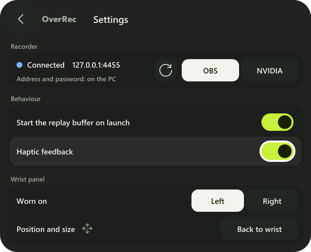

# The panel's gear

In VR, press **⚙** at the top right of the panel. "＜" at the top left goes back.

| Item | What it does |
|---|---|
| Recorder | Whether OBS is connected, and to where. ⟳ (Reconnect) connects again. **OBS / NVIDIA** switches the recorder OverRec works ([Recording with NVIDIA App](/nvidia)) |
| Start the replay buffer on launch | The same item as in [the PC's "OBS"](/settings/pc#obs) |
| Haptic feedback | The same item as in [the PC's "VR controls"](/settings/pc#vr) |
| Worn on | The hand the panel is on (Left / Right). Changed only here ([Which hand](/customize#hand)) |
| Position and size | "Back to wrist" puts it back at its first place and size |

The address and password cannot be changed inside VR. Change them in [the PC's "Connection"](/settings/pc#connection).
