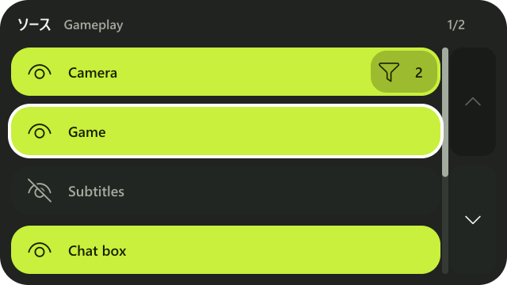
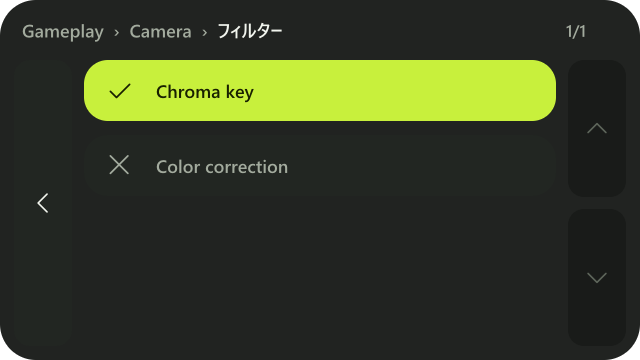
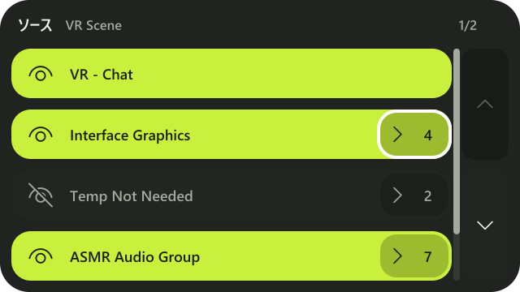
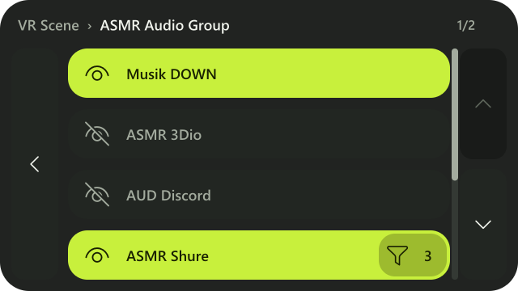

# Turning sources and filters on and off

**You can show or hide the current scene's sources from inside VR.** You can also turn the filters on a source on or off. Use it to bring in or out only the game camera, an overlay or subtitles.

:::note
It only switches things on and off. Adding or deleting sources, changing their position or size, and adjusting a filter's settings are done in OBS on the PC.
:::

## Opening and closing {#open}

There is a handle on the **bottom edge** of the panel.

1. Point at the handle, pull the trigger and let go.
2. The sources drawer comes out under the panel.
3. Press the handle again to put it away.

The drawer is out only while the panel is. When you lower your wrist and the panel goes, the drawer goes too.

## Switching a source {#toggle}

Each row of the list is one source. **Press a row to show or hide it.**

| It looks like | State |
|---|---|
| An eye on lime | Shown |
| A crossed-out eye on dark | Hidden |

- Four show at a time. When there are more, turn the page with the up and down arrows on the right.
- The thin bar beside the list shows where you are in the whole list.
- A long name is cut short.

## Switching filters {#filters}

A source that has filters shows a **filter button** at the right end of its row (a funnel and a number). Press it and the list becomes that source's filters; press a row to turn it on or off.

The tall button on the left takes you back to the list of sources.

## Opening a group {#groups}

An OBS **group** is opened with the button at the right end of its row. Pressing the row itself shows or hides the whole group.

Opened, it lists the sources inside. A group inside a group opens the same way.

- The heading shows **where you are**, like "Scene › Group". The rightmost part is the place you are at; what leads to it is dimmer. When it is too deep to fit, the start is shortened to "…".
- The tall button on the left goes back one step.
- Going in or out, the list slides sideways: in from the right going in, from the left coming back. Turning a page slides it up or down.

## In Studio Mode {#studio}

When you use OBS's **Studio Mode**, the drawer lists the sources of the **preview scene**. The heading says "Preview" so you can tell.

What you switch here changes only the preview side. What goes into the stream or recording does not change until you run the transition in OBS on the PC.

When you turn Studio Mode on or off, or change the preview scene, the list becomes that scene's.

## When it does not work {#trouble}

| Symptom | What to check |
|---|---|
| I cannot find the handle | It is on the panel's bottom edge. Bring the panel out by looking at your wrist |
| Pressing does not switch it | Whether OBS is connected (the panel's top row says "OBS connected") |
| The list is empty | That scene (in Studio Mode, the preview scene) has no sources |
| A row is not the source I expected | When the scene changes, the drawer changes to that scene's list |
