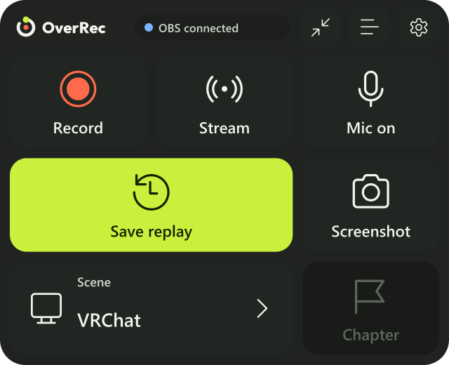
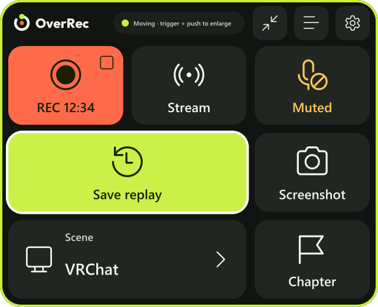

# The basics

Have SteamVR, OBS Studio and OverRec running. You are ready when, at the bottom right of the PC settings window, **OBS** says "Connected" and **SteamVR** says "Linked".

## Showing the panel {#show}

**Turn your left wrist toward your face**, as if looking at a watch. The panel appears on the wrist. Turn the wrist away and it goes.

To wear it on the right hand, change it from the panel's gear ([Which hand](/customize#hand)).

## Pressing a button {#press}

**Point at a button with the other hand's controller (the right hand by default), then pull the trigger and let go.**

- A white dot shows where you are pointing.
- The button is pressed when you let go on it. Move off the button before letting go and it is not pressed.
- **Stopping** a recording or a stream takes a second press to confirm (so a slip does not stop it).

Each button is explained in [The panel's buttons](/panel).

## Grabbing and moving the panel {#grab}

Point at the panel with the right hand and **squeeze the grip** to grab it.

| To | Do this |
|---|---|
| Move it | Move your hand while squeezing the grip |
| Move it nearer or further | While holding it, tilt the stick up or down |
| Resize it | While holding it, pull the trigger too: push your hand forward to enlarge, pull back to shrink |
| Leave it there | Let go of the grip |

Where you leave it is remembered relative to the wrist. Left far from the wrist, it goes back to its place on the wrist.
If you lose it, [Back to wrist](/customize#reset) puts it back at its first place and size.

## When the game reacts to presses on the panel {#global-input}

To keep the trigger that presses the panel from reaching the game, turn on **"Enable global input from overlays"** in SteamVR's settings.
OverRec works without it, but the trigger that presses the panel reaches the game too.

## Quitting

Right-click OverRec's icon in the Windows system tray and choose "Quit".
If you cannot see the icon, press "^" at the right end of the taskbar.
