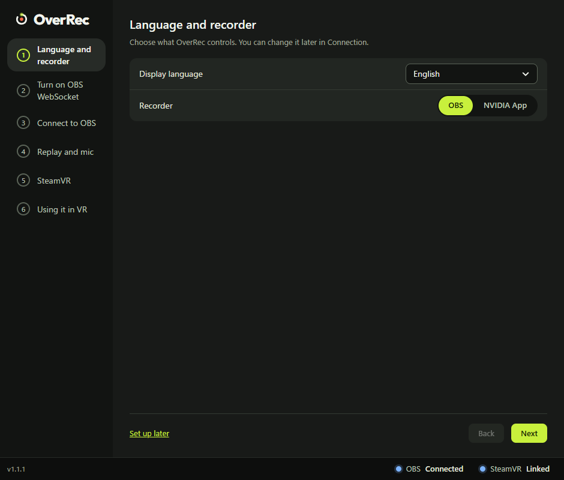
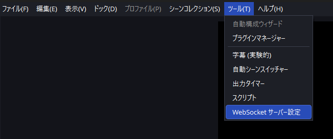
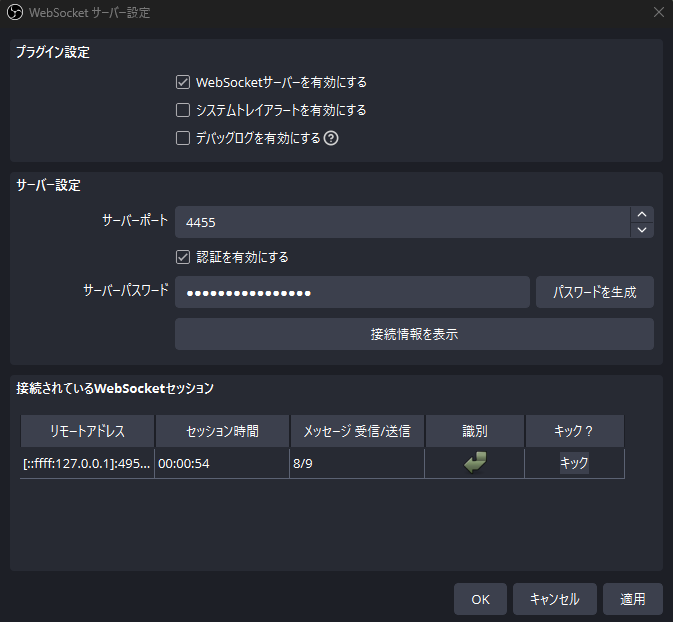

# First-time setup

The first time OverRec starts, the **first-run guide** opens. It has six steps and takes about five minutes at the PC.

To do it again later, open it from "Troubleshooting" → "Show the guide" in the settings window.

## 1. Language and recorder {#recorder}

Choose the display language, and the recorder OverRec works.

- **OBS**: OverRec works OBS Studio. The next steps get OBS ready.
- **NVIDIA App**: OverRec works NVIDIA App's recording through its hotkeys. The OBS steps (2 to 4) are skipped, and the guide goes on to [SteamVR](#steamvr). To get NVIDIA App ready, see [Recording with NVIDIA App](/nvidia#prepare).

You can change it later in "Connection" in the settings window.

## 2. Turn on OBS's WebSocket {#websocket}

OverRec works OBS through OBS's WebSocket feature. Turn it on once in OBS.

1. Open **"Tools"** in OBS Studio's menu.
2. Choose **"WebSocket Server Settings"**.

   

3. Check **"Enable WebSocket server"**. Leave "Enable Authentication" on.
4. Press **"Apply"**.

   

## 3. Connect to OBS {#connect}

Enter what the same "WebSocket Server Settings" window shows into OverRec.

| Field in OverRec | What to enter |
|---|---|
| Address | Leave `127.0.0.1` when OBS is on the same PC |
| Port | OBS's "Server Port" |
| Password | OBS's "Server Password". It is hidden: see and copy it with "Show Connect Info" |

"Next" tries the connection before going on. If it cannot connect, the reason is shown there.

## 4. Replay and mic {#replay}

- **Replay buffer**: the OBS feature behind "save the last few tens of seconds". Choose a length (30 s, 60 s or 120 s) and press **"Set up in OBS"**. It changes OBS's output settings, so press once more to go ahead.
- **Mic input**: the OBS audio input that the panel's mic button mutes.

:::note
If saving a replay does not work after "Set up in OBS", restart OBS.
:::

## 5. SteamVR {#steamvr}

- **Start with SteamVR**: when on, OverRec starts when SteamVR does.
- **Controller bindings**: the buttons used without opening the panel ([Controller bindings](/customize#bindings)). You can set them later too.

This step can be set while SteamVR is running. If it is not, skip it and change it later in "General".

## 6. Using it in VR

Last, the guide shows how to use OverRec in VR. "Done" turns the window into the settings.

Go on to [The basics](/start/basics).

## After closing the settings window

- **Minimizing** the window puts it in the Windows system tray. Press OverRec's icon in the tray to open it again.
- **Closing the window with "×" quits OverRec.** To keep using it after closing, turn on "General" → "Closing puts it in the system tray".
- By default, OverRec quits when SteamVR does.
